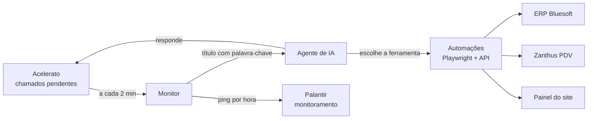

# IA de Suporte Técnico


Agente de IA que atende sozinho chamados de TI de uma rede de supermercados. Ele lê o chamado no Acelerato (sistema de chamados), entende o pedido, executa a tarefa nos sistemas da empresa e responde ao solicitante, sem intervenção humana.

Tira do time de TI as tarefas repetitivas do dia a dia e atende a qualquer hora, inclusive fora do expediente.

## O que a IA faz

- **Cargas de preço nas lojas**: gera a carga no ERP Bluesoft e envia para os PDVs pelo Zanthus, para uma loja, várias lojas ou um conjunto (por estado ou bandeira). As cargas rodam em fila, uma de cada vez.
- **Vouchers promocionais**: cria vouchers de valor fixo ou porcentagem, em lote, para as lojas pedidas, conferindo antes se a data de validade é futura.
- **Derrubar packs de promoção**: inativa packs no Zanthus na hora ou agenda para o fim do expediente, com a carga feita de madrugada.
- **Troca de senha no ERP**: dispara a redefinição de senha de funcionários na Bluesoft a partir do CPF e informa o e-mail que vai receber o link.
- **Relatório diário de e-books**: baixa o relatório de vendas de e-books do Zanthus e publica o CSV no painel do site.
- **Importação de e-books**: baixa a planilha anexada ao chamado, padroniza e importa no Zanthus.
- **Resposta no chamado**: avisa quando começa, informa o resultado e anexa um print da tela como comprovante.
- **Acompanhamento por 3 dias**: depois de atender, continua lendo o chamado e responde a novos comentários do solicitante. Para quando o chamado é concluído, excluído ou retirado da IA.
- **Falhas tratadas**: se uma automação falha, a IA explica o erro no chamado e avisa que basta comentar para ela tentar de novo.
- **Pausa de emergência**: um chamado com `__pause__` no título suspende a IA até ser concluído.

## Como funciona



1. O monitor consulta os chamados pendentes da equipe de TI a cada 2 minutos.
2. Chamados com palavra-chave no título (`carga`, `voucher`, `senha`, `derrubar`...) vão para o agente.
3. O agente lê o chamado e os anexos, valida os dados e chama a ferramenta certa.
4. As ferramentas operam os sistemas web com um navegador automatizado (Playwright) ou pela API REST do Acelerato.
5. O resultado volta para o chamado como comentário.

### Monitoramento com Palantir

O **Palantir** é o serviço de monitoramento interno do time: ele recebe um sinal de vida (*heartbeat*) de cada robô e acusa quando algum para de enviar. O agente manda um `POST` para o Palantir uma vez por hora, sempre depois de um ciclo bem-sucedido. Se o Palantir não receber o sinal dentro de 1h mais 15 minutos de tolerância, marca a IA como parada e o time fica sabendo antes de os chamados acumularem. Se o próprio Palantir estiver fora do ar, o agente só registra um aviso no log e continua trabalhando.

## Tecnologias

| Tecnologia | Uso no projeto |
|---|---|
| **Python 3.13** | Linguagem do projeto, com type hints e dataclasses |
| **[Agno](https://github.com/agno-agi/agno)** | Framework do agente: ferramentas, instruções e hooks de execução |
| **LLM (modelo de linguagem)** | Interpreta os chamados e decide a ação; o provedor é trocável |
| **Playwright** | Automação web (Chromium headless) no ERP, no PDV e no painel |
| **Requests** | Integração com a API REST do Acelerato |
| **Pandas + openpyxl** | Leitura e padronização de planilhas e CSVs |
| **schedule** | Agendamento das tarefas de fim de expediente |
| **Docker + Docker Compose** | Execução contínua em servidor Linux com reinício automático |
| **uv** | Gerenciamento de dependências com lockfile reprodutível |

## Destaques técnicos

- **Arquitetura modular**: o monitor, o agente, o cliente do Acelerato e o monitoramento são peças separadas, montadas em `Agente.py`. Trocar o provedor de LLM (por exemplo, para DeepSeek) é mudar uma função.
- **Adapter da API**: a API do Acelerato fica atrás de uma classe com dados tipados, e o resto do código não lida com JSON cru.
- **Hook de falhas**: toda chamada de ferramenta passa por um hook que captura exceções e garante que o solicitante seja avisado.
- **Instruções com data atual**: o prompt é recarregado a cada atendimento, para que a data de hoje continue certa num processo que roda por semanas (a validação de vouchers depende disso).
- **Cargas em fila**: uma trava impede que duas cargas rodem ao mesmo tempo nos mesmos sistemas.
- **Resiliência**: timeout em todas as chamadas HTTP, erro em um chamado não derruba o ciclo e o container reinicia sozinho.
- **Configuração segura**: credenciais e URLs ficam só no `.env`, e o agente não inicia se faltar alguma variável obrigatória.

## Estrutura

```
Agente.py            ponto de entrada: monta as peças e inicia o loop
agente/
  config.py          parâmetros (palavras-chave, intervalos, modelo)
  acelerato.py       adapter da API do Acelerato com dados tipados
  ia.py              modelo, agente Agno, hook de falha e atendente
  monitor.py         loop de chamados e acompanhamento de 3 dias
  palantir.py        heartbeat para o Palantir
data/                ferramentas do agente (Playwright + API)
instructions/        prompts do agente
```

## Como executar

Copie `.env.example` para `.env` e preencha as credenciais e URLs.

**Docker (recomendado)**

```bash
docker compose up -d --build
docker compose logs -f
```

**Local**

```bash
uv sync
uv run playwright install chromium
uv run python Agente.py
```

Sem o uv: `pip install -r requirements.txt`.

## Configuração

| Onde | O quê |
|---|---|
| `agente/config.py` | Palavras-chave, dias de acompanhamento, intervalos e modelo |
| `.env` | Credenciais, URLs dos sistemas e `PALANTIR_URL` |
| `agente/ia.py` → `criar_modelo` | Troca do provedor de LLM |

## Autor

**Victor José Costta Lameiro**
[LinkedIn](https://www.linkedin.com/in/victorjcl) · [GitHub](https://github.com/victorjcl)
